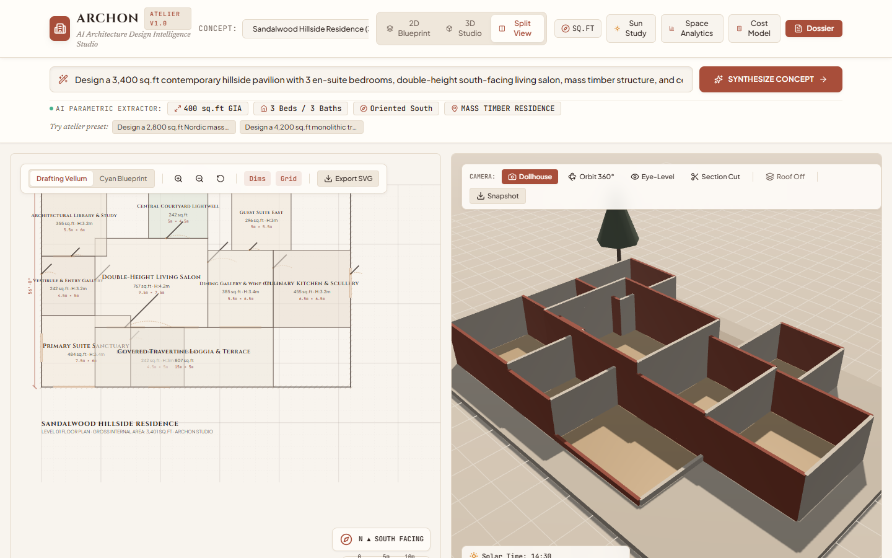
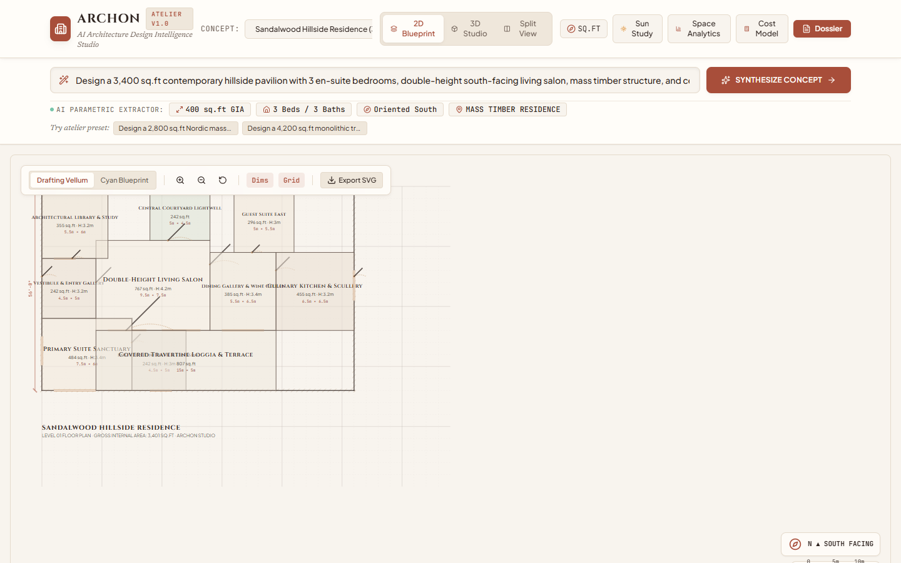
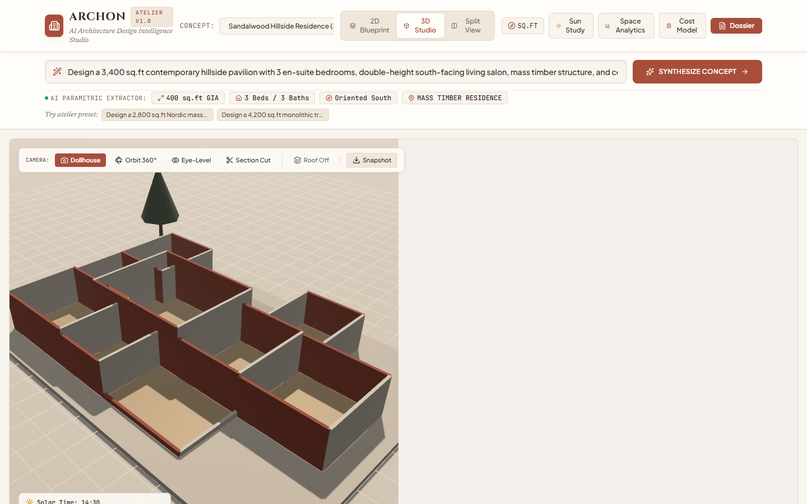
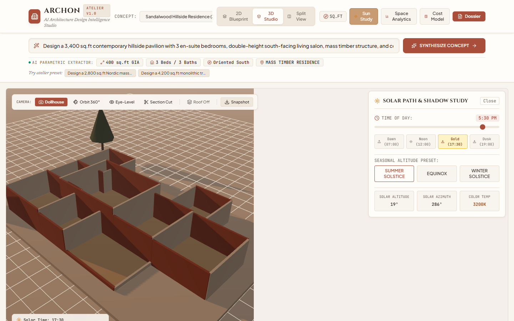
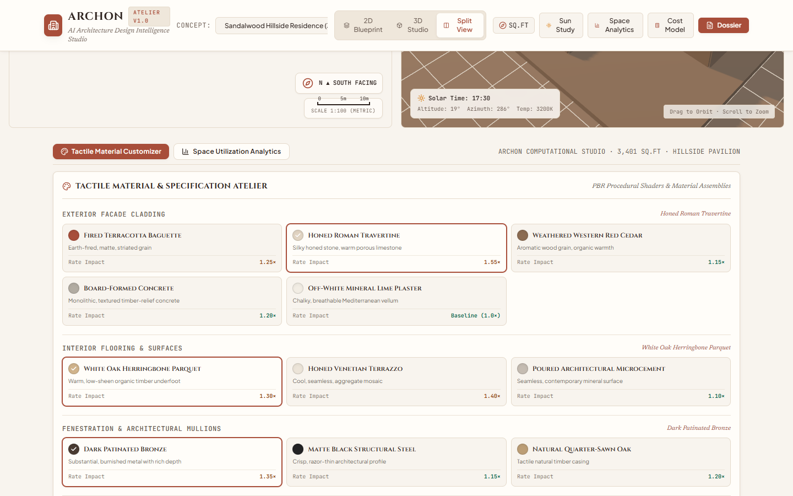
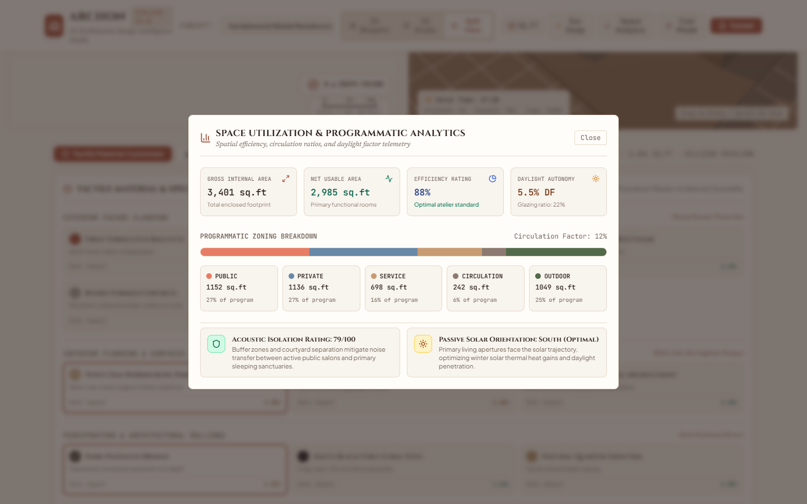
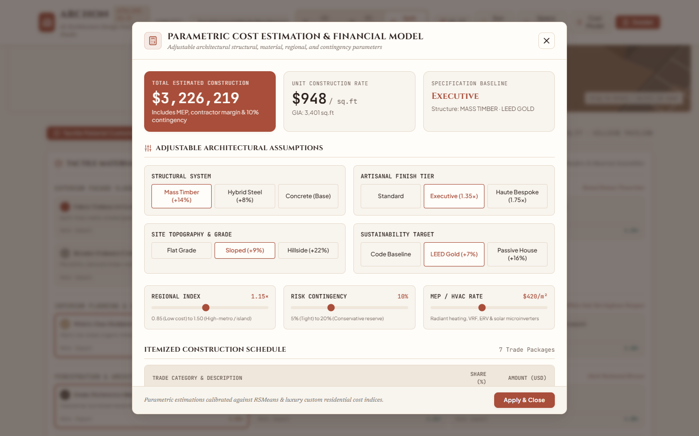
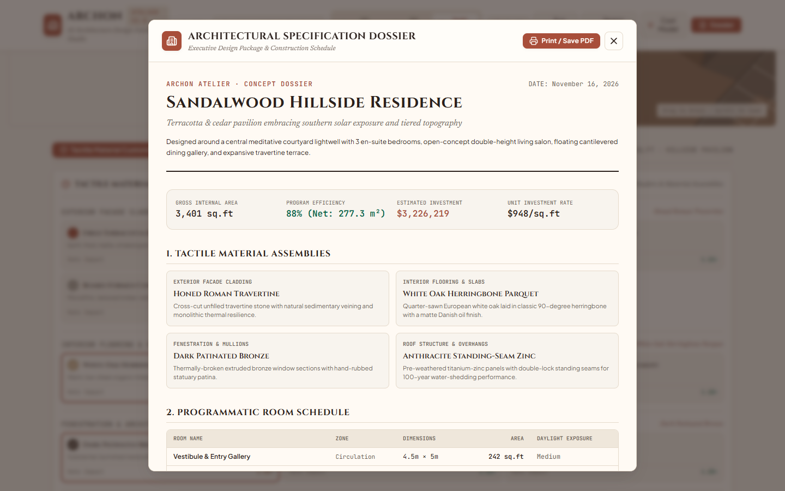

# 🏛️ ARCHON — AI Architecture Design Intelligence Studio

> **Vision:** A high-craft, tactile architectural design intelligence studio that transforms natural-language briefs into conceptual building designs, generative 2D vector blueprints, real-time 3D WebGL spatial models, dynamic sun-path solar shadow studies, tactile material customization, space utilization analytics, and parametric cost estimation models with adjustable assumptions.

---

## 📋 Project Specifications & Properties

| Property | Value |
| :--- | :--- |
| **System Name** | **ARCHON** (AI Architecture Design Intelligence) |
| **Workspace Root** | `L:\pr 18(ARCHON)` |
| **Aesthetic Theme** | **Terracotta & Linen** (Tactile Architectural Atelier, Grounded Organic Contemporary) |
| **Typography** | `Cinzel` / `Newsreader` (Editorial Architectural Display) + `Plus Jakarta Sans` & `JetBrains Mono` |
| **Primary Palette** | Terracotta `#A84E3A` · Linen Vellum `#F8F4EE` · Alabaster `#FFFDF9` · Graphite `#2B201C` · Brass `#C89B72` · Blueprint `#243B53` |
| **Technology Stack** | React 19 · TypeScript 5.8 · Vite 6 · Three.js (PBR WebGL) · Tailwind CSS · Vector SVG Engine · Playwright |
| **Verification State** | 🟢 **100% Verified** (8/8 High-Resolution Visual Evidence Artifacts Captured) |
| **Live Production URL** | 🌐 **[archon-ai-architecture.vercel.app](https://archon-ai-architecture.vercel.app)** (Vercel) |
| **Live Local Port** | `http://localhost:4288/` |

---

## 🖼️ Verified Visual Verification Gallery

> 📌 **Architectural Evidence Record:** Every core interface, vector blueprint projection, WebGL PBR material rendering, solar shadow simulation, space analytics breakdown, and parametric cost schedule was verified via headless Chromium and captured directly into `./screenshots/` and `L:\pr 15(esp)\sendiing files\screenshots\15_ARCHON\`.

| Architectural Viewport | Spatial Capability & Telemetry |
| :--- | :--- |
|  | **01 · Master Atelier Concept Generator (Split View)**<br>Integrated dual-pane workspace combining generative 2D vector blueprint drafting with real-time 3D WebGL isometric dollhouse massing. Features natural-language brief ingestion with real-time AI parameter extraction (GIA, bed/bath count, solar orientation, and typology). |
|  | **02 · Interactive 2D Blueprint Drafting Canvas**<br>Precision Cartesian drafting canvas with 1m/5m coordinate grids, double-line exterior walls with poché hatching, partition walls, door swing arcs, casement windows, room dimension tags ($m^2$ / sq.ft), dimension chains, and graphic scale. |
|  | **03 · 3D WebGL Isometric Dollhouse Cutaway**<br>Full-screen interactive Three.js 3D model featuring extruded terracotta walls, quarter-sawn oak herringbone floors, bronze-framed fenestration, central courtyard reflection pool, and surrounding landscape vegetation. |
|  | **04 · Solar Path & Shadow Study Simulation**<br>Dynamic celestial solar calculator simulating solar altitude ($\theta=19^\circ$), azimuth ($\phi=286^\circ$), and $3200K$ amber color temperature at 17:30 Golden Hour, casting soft directional shadows across facades and courtyards. |
|  | **05 · Tactile Material & Envelope Customizer**<br>Interactive material switcher updating PBR shaders and parametric costs across 4 assemblies: Honed Roman Travertine, Architectural Microcement, Dark Patinated Bronze, and Anthracite Standing-Seam Zinc. |
|  | **06 · Space Utilization & Programmatic Circulation Analytics**<br>Telemetry dashboard displaying Gross Internal Area (3,401 sq.ft), Net Usable Area (2,985 sq.ft), 88% spatial efficiency rating, 5.5% daylight autonomy factor, acoustic isolation score (79/100), and color-coded programmatic zoning. |
|  | **07 · Parametric Cost Estimation & Financial Model**<br>Parametric budget engine with interactive sliders for Structural Systems (Mass Timber / Steel / Concrete), Finish Tiers (Executive 1.35×), Regional Cost Multipliers (1.15×), Risk Contingency (10%), and 7-trade itemized construction schedule ($3,226,219 total). |
|  | **08 · Architectural Specification Dossier & Presentation**<br>Publication-ready executive client presentation package featuring project narratives, material specification schedule, programmatic room matrices, budget summaries, and print/PDF export readiness. |

---

## 🏛️ Core Architectural Innovations

### 1. Natural-Language Architectural Brief Engine
- **Parametric Intent Parsing:** Translates unstructured design prompts into structured architectural constraints (target Gross Internal Area, room counts, solar orientation, climate vernacular, and structural systems).
- **Curated Typologies:**
  - *Sandalwood Hillside Residence* (3,401 sq.ft, Terracotta & Cedar cantilever pavilion)
  - *Nordic Mass-Timber Atelier* (2,745 sq.ft, Glulam portal frames with living sedum green roof)
  - *Travertine Monolith Villa* (4,252 sq.ft, Cross-cut Roman travertine with peristyle reflection pool)
  - *Urban Infill Micro-Atelier* (1,680 sq.ft, High-efficiency vertical spatial zoning)

### 2. Generative 2D Floor Plan Engine
- **Vector SVG Blueprint Engine:** Dual-mode styling supporting *Drafting Vellum* (warm linen paper with graphite ink) and *Cyan Blueprint* (technical navy with white drafting ink).
- **Drafting Precision:** Includes room adjacency graphs, door swing geometry, fenestration punches, dimension strings with 45-degree architectural slash ticks, and true-north orientation compass rose.

### 3. Real-Time 3D WebGL Studio (Three.js)
- **Camera Viewports:** Instant switching between *Isometric Dollhouse*, *360° Orbit*, *Eye-Level Walk (1.65m)*, and *Cross-Section Cutaway Plane*.
- **Solar Shadow Simulation:** Computes solar altitude and azimuth across Summer Solstice, Equinox, and Winter Solstice with real-time shadow projection and Kelvin color temperature shifts.

### 4. Tactile Material & Envelope Customizer
- **PBR Material Library:** Physical roughness, metalness, and procedural shading for Fired Terracotta Baguettes, Roman Travertine, Weathered Cedar, Board-Formed Concrete, White Oak Parquet, Honed Terrazzo, Bronze Mullions, and Zinc Standing-Seam roofs.
- **Budget Feedback:** Every material change dynamically updates the project's financial model and construction schedule.

### 5. Parametric Cost Estimation Engine
- **Custom Residential Benchmarks:** Base construction rate calibrated at $2,450 / m² ($228 / sq.ft base), dynamically adjusted by:
  - *Structural System:* Mass Timber (+14%), Hybrid Steel (+8%), Concrete Frame (Base)
  - *Artisanal Finish Tier:* Standard (1.0×), Executive (1.35×), Haute Bespoke (1.75×)
  - *Site Topography:* Flat Grade (1.0×), Sloped (+9%), Hillside (+22%)
  - *Sustainability Standard:* Code Baseline (1.0×), LEED Gold (+7%), Passive House (+16%)
  - *Regional Cost Index:* 0.85× to 1.50×
  - *MEP / HVAC & Contingency:* Dedicated radiant/ERV allowance and 5–20% risk reserves.

---

## 🛠️ Technology Stack & Architecture

```
L:\pr 18(ARCHON)
├── index.html                   # HTML5 Entry with Google Fonts (Cinzel, Plus Jakarta Sans, JetBrains Mono)
├── package.json                 # React 19, Three.js, Lucide, Tailwind CSS, Vite
├── vite.config.ts               # Vite configuration with optimization
├── tsconfig.json                # Strict TypeScript configuration
├── tailwind.config.js           # Terracotta & Linen theme tokens & typography
├── screenshots/                 # 8 Verified high-resolution visual evidence captures
├── scripts/
│   └── capture_visuals.js       # Playwright automated visual verification harness
├── src/
│   ├── main.tsx                 # App bootstrapping
│   ├── App.tsx                  # Master Studio Container (State & Viewports)
│   ├── types/
│   │   └── architecture.ts      # Domain models (FloorPlan, Room, Material, CostModel, SunState)
│   ├── data/
│   │   └── presetProjects.ts    # Rich architectural typologies & material catalog
│   ├── services/
│   │   ├── planGenerator.ts     # Generative floor plan synthesis & NLP parser
│   │   ├── costEstimator.ts     # Parametric cost calculation with adjustable assumptions
│   │   └── analyticsEngine.ts   # Space utilization, circulation, and daylight scoring
│   ├── components/
│   │   ├── Header.tsx           # Atelier brand bar, concept switcher, unit toggle
│   │   ├── PromptEngine.tsx     # Natural-language brief input with live AI badges
│   │   ├── ViewportContainer.tsx# Persistent 2D/3D split-screen orchestrator
│   │   ├── FloorPlanCanvas.tsx  # Interactive 2D vector architectural blueprint canvas
│   │   ├── ThreeStudio.tsx      # Three.js 3D WebGL visualizer with PBR shaders & dollhouse
│   │   ├── SunPathControls.tsx  # Solar altitude/azimuth shadow simulator controls
│   │   ├── MaterialPalette.tsx  # Tactile interior/exterior material switcher
│   │   ├── SpaceAnalytics.tsx   # Space efficiency, circulation, and daylight telemetry
│   │   ├── CostEstimatorModal.tsx# Deep-dive cost breakdown with adjustable assumption sliders
│   │   └── ExportDossier.tsx    # Architectural specification package preview and download
│   └── styles/
│       └── index.css            # Tailored drafting paper background, scrollbars, micro-interactions
```

---

## 🚀 Local Development & Execution

```bash
# 1. Install dependencies
npm install

# 2. Start Vite development server
npm run dev

# 3. Build production bundle (TypeScript + Vite)
npm run build

# 4. Preview production build
npm run preview -- --port 4288

# 5. Execute automated Playwright visual verification harness
node scripts/capture_visuals.js
```

---

> 🚀 **LinkedIn Publication Schedule:**
> - **Approval:** Yes
> - **Pushed to GitHub:** `2026-11-16`
> - **Scheduled LinkedIn Release:** `2026-11-17` at 23:00 IST (24h post-push showcase, Queue Position 15 after the 14 portfolio posts)
> - **Publication Status:** Scheduled

<!-- linkedin-automation: {"status": "approved", "project_id": "15_ARCHON", "day": 15, "pushed_date": "2026-11-16", "scheduled_date": "2026-11-17", "published": false} -->
